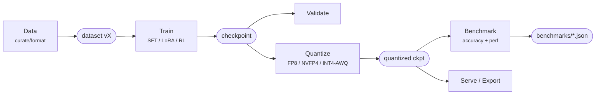

# Pipeline / architecture diagrams (bao-design)

## 1. Before drawing
- Get the **stage list and tool names from the source of truth**: accepted ADR in `docs/adr/`, else ask
  bao-research (stack) / bao-backend (modules, CLI). Never draw a tool that is not pinned in an ADR without marking it `(proposed)`.
- One diagram = one question. Types: `pipeline` (stages), `lineage` (artifacts & IDs), `deploy` (containers `vlm-*`,
  ports, volumes, shared host), `sequence` (CLI → module calls).

## 2. Conventions
- Default syntax: Mermaid `flowchart LR` (renders on GitHub/most markdown). `architecture-beta` only after confirming the renderer supports Mermaid ≥ 11.1.
- ≤ 15 nodes per diagram; split into an overview + detail diagrams otherwise.
- Node label: `Stage<br/><small>tool</small>`; artifacts as stadium shapes `([ckpt])`, processes as rects.
- Stage classes (same in light/dark; text dark on light fill):
```mermaid
%% paste at bottom of every pipeline diagram
classDef data fill:#cde2fb,stroke:#2a78d6,color:#0b0b0b;
classDef train fill:#fde3d8,stroke:#eb6834,color:#0b0b0b;
classDef quant fill:#d3f2e6,stroke:#1baf7a,color:#0b0b0b;
classDef eval fill:#fbe9b8,stroke:#c98500,color:#0b0b0b;
classDef serve fill:#e3dffa,stroke:#6250d6,color:#0b0b0b;
classDef artifact fill:#f0efec,stroke:#898781,color:#0b0b0b;
```
- Caption under each diagram: hardware (DGX Spark GB10, aarch64, 128GB unified), versions/ADR refs, date.

## 3. Skeleton (fill from ADR)


## 4. Files & check
- Source: `docs/diagrams/<name>.mmd` and embedded in the doc's markdown; SVG export (if needed) to `docs/diagrams/<name>.svg`:
  `npx -y @mermaid-js/mermaid-cli@11 -i docs/diagrams/x.mmd -o docs/diagrams/x.svg` (arm64 OK; needs Chromium — if unavailable, keep .mmd only).
- Review: ask the stage owner (bao-backend/bao-research) to confirm correctness; log in `.team/log/`.
