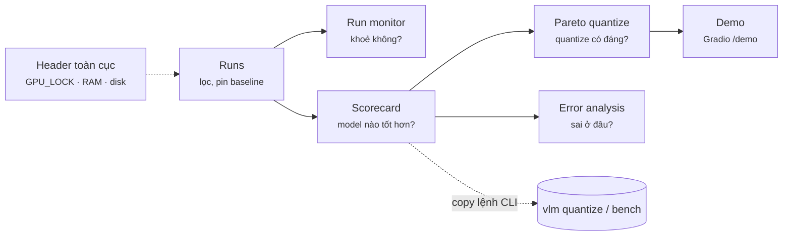

# Proposal 006 — Phụ lục A: UX flow, màn hình, wireframe, design system
Tác giả: bao-design · 2026-10-12 · DRAFT · Đi kèm `006-dashboard-scope-design-system.md` (§5, §6)
Input đã tổng hợp: bao-frontend (contract, stack), bao-tester (CI/gate/reproducible), bao-backend (lineage, CLI),
bao-cleanup (ngưỡng RAM/disk, retention), bao-security (badge license/remote code/unpinned). Nền: `.team/knowledge/design.md`.

---

## A1. Nguyên tắc UX (định hướng mọi quyết định bên dưới)
1. **Mỗi màn hình trả lời 1 câu hỏi** trong luồng: theo dõi → so sánh → chọn → (quantize) → so sánh lại → demo.
2. **Không làm lại W&B/MLflow.** Giá trị riêng: lineage base→sft→fp8/nvfp4/int4, Pareto quantize, an toàn máy dùng chung
   (GPU_LOCK + unified memory), error-analysis VLM (ảnh + prompt + GT + pred).
3. **Không tuyên bố điều dữ liệu không chứng minh**: Δ có CI95 chứa 0 → xám "không khác biệt"; số thiếu metadata →
   badge "not reproducible"; base FAIL sanity gate → mọi so sánh dựa trên nó có cảnh báo; perf khác điều kiện → không so.
4. **Read-only v1**: UI không launch/kill job. Mỗi chỗ "hành động" là **lệnh CLI copy được** (`vlm bench …`).
5. Mật độ thông tin cao, chrome tối giản; dark + light theo system, toggle được.

## A2. Luồng người dùng v1


Caption: v1 read-only; DGX Spark GB10, 127.0.0.1:7870.

| # | Màn hình | Câu hỏi chính | Ưu tiên |
|---|---|---|---|
| a | Header toàn cục (mọi trang) | "Máy có rảnh/an toàn để chạy không?" | v1 P0 |
| b | Runs list | "Có những run nào, run nào là champion/baseline?" | v1 P0 |
| c | Run monitor | "Run này có khoẻ không, có sắp OOM không?" | v1 P0 |
| d | Scorecard (compare) | "Model nào tốt hơn, ở benchmark nào, có ý nghĩa thống kê không?" | v1 P0 |
| e | Pareto quantize | "Precision nào đáng ship?" (tab trong Scorecard) | v1 P0 |
| f | Error analysis | "Model sai ở mẫu nào, base vs ft khác gì?" | v1 P1 (nếu backend lưu predictions) |
| g | Demo (Gradio) | "Trả lời ảnh/video của tôi ra sao?" | v1 P1 |
| h | Lineage card / export | "Artifact ở đâu, chạy lại thế nào?" | v1.1 |
| i | Storage/retention (dry-run) | "Cái gì sắp bị xoá và vì sao?" | v1.1 (bao-cleanup yêu cầu) |

## A3. Wireframe thô

### (a) Header toàn cục — luôn hiển thị
```
┌──────────────────────────────────────────────────────────────────────────────────────────────┐
│ ▣ VLM Lab   Runs  Scorecard  Demo        GPU ● BUSY bao-backend · sft-lora · 14:02 · PID 4121 │
│                                          RAM [███████████▓▓▓▓▒▒▒░░░░] avail 31 GB ⚠  Disk 1.4 TB │
└──────────────────────────────────────────────────────────────────────────────────────────────┘
```
- GPU: `● FREE` (good) / `● BUSY <ai> · <job> · <từ> · PID` (neutral, không phải lỗi) / `⚠ STALE LOCK` (host PID không còn — serious, kèm hướng dẫn báo PM; **không nút xoá**). Yêu cầu: GPU_LOCK ghi **PID phía host** (không phải PID trong container), nếu không sẽ báo stale sai.
- RAM stacked, tổng = **MemTotal đọc từ /proc/meminfo** (máy báo ~121 GB, không hard-code 128): `other` = used − vlm jobs (xám) | `vlm jobs` = Σ job_rss_gb của run đang chạy từ system.jsonl (accent) | `buff/cache` (sọc nhạt, tooltip "kernel có thể thu hồi") | `free`. Dashboard **không** đọc docker.sock (≈ quyền root).
  Nhãn bên cạnh là **MemAvailable** (con số quyết định). Ngưỡng (P005 D6): warn < 20 GB, critical < 10 GB.
  Disk free: warn < 500 GB, critical < 200 GB. Status = màu + icon + chữ.
- GPU util/clock/power/temp: hiển thị trong Run monitor, gắn nhãn `unverified` cho tới khi bao-backend xác minh trên GB10.

### (b) Runs list
```
Runs   [Bảng | Biểu đồ]   🔍 stage:train tag:champion        Hiển thị: 24 · Đã chọn 3/8  [So sánh ▸]
┌──┬────┬───────────────────┬────────┬──────────┬───────────┬──────────┬──────────┬──────────────┐
│☑ │📌  │ run_id            │ stage  │ status   │ parent    │ precision│ MMMU Δ   │ started      │
├──┼────┼───────────────────┼────────┼──────────┼───────────┼──────────┼──────────┼──────────────┤
│☑ │📌  │ base-qwen…  (base)│ eval   │ ✓ done   │ —         │ BF16 ●   │ —        │ 10-12 09:10  │
│☑ │    │ sft-lora-a1f3     │ train  │ ◐ running│ ds@9c2e   │ BF16 ●   │ +2.1 ±0.8│ 10-12 14:02  │
│☑ │    │ q-nvfp4-77b0      │ quant  │ ✓ done   │ sft-a1f3  │ NVFP4 ◆  │ −0.3 ±0.9│ 10-12 15:40  │
└──┴────┴───────────────────┴────────┴──────────┴───────────┴──────────┴──────────┴──────────────┘
```
- Chọn tối đa 8 run (cap categorical); selection giữ nguyên khi chuyển Bảng ⇄ Biểu đồ. Run pinned luôn ở đầu.
- `run_id` mono; tooltip chỉ khi bị cắt; cột parent click → nhảy tới run cha (lineage).
- Δ xám khi CI chứa 0.

### (c) Run monitor
```
sft-lora-a1f3  ◐ running · step 1 240/5 000 · ETA 2h10 · ⓘ config  ⓘ lineage   [copy: vlm runs show sft-lora-a1f3]
┌ loss (train ─ / val ●) ─────────────┐ ┌ lr ───────────────┐ ┌ grad_norm ─────────┐
│ raw mờ + smoothed (EMA 0.9, toggle) │ │                   │ │ ✕ NaN/inf marker    │
└─────────────────────────────────────┘ └───────────────────┘ └────────────────────┘
┌ tokens/s ──────────┐ ┌ job memory (GB) ─────────────┐ ┌ GPU clock/power/temp  [unverified] ┐
│ stat tile + sparkline│ │ torch max_alloc · RSS + RAM avail│ │ phát hiện throttle (clock ghim)    │
└──────────────────────┘ └──────────────────────────────┘ └────────────────────────────────────┘
events: 14:02 start · 14:40 ckpt-500 saved · 15:20 eval val ...            log tail (200 dòng, pause)
```
- Refresh SSE 2–5 s, có Pause; panel stale > 2 phút → nhãn "dữ liệu cũ (hh:mm)".
- Không dual-axis: loss và lr là 2 chart riêng; trục x step thống nhất, crosshair đồng bộ giữa các chart.

### (d) Scorecard — trung tâm ra quyết định
```
Scorecard   Baseline: base-qwen… (BF16) ▾     Hiện: ☑ published  ☐ judge-based   [Bảng | Pareto | Error analysis]
⚠ Base FAIL sanity gate trên DocVQA (lệch −3.4 so với model card) — mọi Δ của DocVQA không đáng tin.
┌────────────┬──────────────┬──────────┬──────────────────┬──────────────────┬──────────────────┐
│ benchmark  │ published ◌  │ base ●   │ sft BF16 ●       │ sft FP8 ▲        │ sft NVFP4 ◆      │
├────────────┼──────────────┼──────────┼──────────────────┼──────────────────┼──────────────────┤
│ MMMU (val) │ 58.0         │ 57.2 ±1.1│ 59.3  +2.1 ▲±0.8 │ 59.1  +1.9 ▲±0.8 │ 58.6  +1.4 ±1.5 ░│
│ DocVQA ⚠   │ 94.5         │ 91.1 ±0.4│ 93.0  +1.9 ±0.5  │ …                │ …                │
│ OCRBench   │ 85.2 (/1000→)│ …        │ …                │ …                │ …                │
├────────────┼──────────────┼──────────┼──────────────────┼──────────────────┼──────────────────┤
│ TTFT p50 ms│ —            │ 182      │ 180              │ 121  −33%        │ 97   −46%        │
│ peak mem GB│ —            │ 21.4     │ 21.4             │ 12.0             │ 7.9              │
└────────────┴──────────────┴──────────┴──────────────────┴──────────────────┴──────────────────┘
footer: harness lmms-eval x.y · commit 1a2b3c · GB10 shared host · GPU lock held ✓ · 2026-10-12   [not reproducible: 0]
```
- Hàng = benchmark, cột = variant (thứ tự: published → base → sft → quant theo precision giảm dần) — khớp `frontend-benchmark-viz`.
- Ô: giá trị (thang 0–100, OCRBench đã /10 kèm chú thích) · Δ vs baseline · `±` = **delta_ci95 paired** (không phải CI riêng).
  Δ có ý nghĩa → token `color.delta.better|worse` (xanh lá đậm / đỏ, theo chiều "tốt hơn" của metric) + ▲/▼ — không dùng màu blue vì blue là danh tính base model;
  CI chứa 0 → chữ xám + `░` "không khác biệt". **Chữ số luôn ở màu text, màu chỉ ở chip/mũi tên** (a11y).
- Perf: chỉ so các cột có `perf_conditions` giống nhau; khác → ô hiện `≠ điều kiện` + popover diff (vd `image_size 896 vs 1344`).
- `published` = font nghiêng + viền rỗng, không bao giờ trộn vào trung bình.
- Thiếu giá trị → `—` + tooltip lý do, không bao giờ 0.

### (e) Pareto quantize (tab của Scorecard)
```
Accuracy (MMMU, 0–100) ▲                       chọn trục x: [TTFT p50 ms | tok/s | peak mem GB]
   60 ┤          ● sft BF16 ──┐
      │      ▲ sft FP8 ───────┤  Pareto front (đường bậc thang)
   58 ┤ ◆ sft NVFP4 ──────────┘          ● base BF16
      │ ■ sft INT4-AWQ (dưới floor)
   55 ┼ ─ ─ ─ ─ ─ quality floor: base − 1.0 (chỉnh được) ─ ─ ─ ─ ─
      └────────┬────────┬────────┬────────▶ TTFT p50 (ms, thấp hơn = tốt)   góc tốt: trên-trái
              100      150      200
   GB10 · vLLM x.y · batch 1 · 1 ảnh 896px · in 512 / out 128 tok · median 3 lần (min–max whisker)
```
- Một trục y duy nhất; trục x đổi được (không dual-axis). Error bar dọc = CI95, ngang = min–max perf.
- Hue = dòng model, shape = precision, **direct label mọi điểm** (≤ 8 điểm) — bắt buộc vì màu precision không đủ phân biệt CVD
  trên scatter (đã validate, xem A5.3).
- Điểm dưới quality floor: nhạt + nhãn "dưới floor". Điểm khác `perf_conditions` → không vẽ, liệt kê bên dưới "bị loại vì khác điều kiện".

### (f) Error analysis (P1)
```
DocVQA · lọc: [base đúng, sft sai ▾]  42 mẫu        ◀ 3/42 ▶
┌ ảnh (zoom) ─────────────┐  Q: "What is the invoice total?"     GT: "$1,240.00"
│                         │  base BF16 ●: "$1,240.00"  ✓ ANLS 1.00
│                         │  sft NVFP4 ◆: "$1,24O.00"  ✕ ANLS 0.89   [diff ký tự highlight]
└─────────────────────────┘  prompt_hash 7f3a · max_new_tokens 64 · greedy
```
- Cần backend lưu `predictions.jsonl` per (variant, benchmark) — **câu hỏi mở cho bao-backend/bao-research**.
- Bộ lọc 4 ô ma trận (đúng/sai × đúng/sai) giữa 2 variant là công cụ chính tìm regression do quantize.

### (g) Demo (Gradio `/demo`)
Upload ảnh/video + prompt → so sánh side-by-side tối đa 2 endpoint (vd sft BF16 vs sft NVFP4), hiện TTFT/tok/s mỗi bên.
Banner nếu GPU_LOCK do job khác giữ: "Perf đang bị nhiễu bởi <job>". Theme Gradio map từ tokens (A5).
Output model render **plain text**, hoặc markdown với HTML thô bị tắt (theo bao-security P003).

### (i) Storage / retention dry-run (v1.1, dữ liệu: JSON dry-run của `retention.py`, bao-cleanup)
```
Storage · dry-run 2026-10-12 16:40      Thu hồi được: 123.4 GB   ⚠ Cần phê duyệt: total > 20GB
Lọc: [tất cả | sẽ xoá | strip optim | giữ]                [copy: uv run scripts/cleanup/retention.py --run <id>]
▾ sft-lora-a1f3   ✓ completed                                                       −62.4 GB
   checkpoints/epoch_0_step_500    checkpoint   ⌫ delete       31.2 GB  D3.non_latest_7d  "older than 7d, not LATEST/BEST"
   checkpoints/epoch_1_step_1000   checkpoint   ✂ strip optim  18.0 GB  D3.strip_optim    [LATEST]
   checkpoints/epoch_1_step_900    checkpoint   ● keep          —       —                 [KEEP] [BEST]
▸ grpo-77c1       ◐ running  — chỉ hiển thị, không có action                                   —
```
- 3 action tách bạch: `● keep` (text muted) · `✂ strip optim` (warning — giữ weights, chỉ bỏ optimizer) · `⌫ delete` (critical). Icon + chữ, không chỉ màu.
- Chip vai trò hiện đủ, thứ tự KEEP > LATEST > BEST. Run running/failed/interrupted: dòng mờ, không action; `blocked_by` hiện ở tooltip.
- UI chỉ cung cấp lệnh **dry-run** để copy; lệnh `--apply` **không** có nút copy — xoá thật đi qua quy trình phê duyệt PM/user (CLAUDE.md).

## A4. Trạng thái & badge dùng chung

### 4 state cho mọi panel
| State | Hiển thị |
|---|---|
| loading | skeleton đúng kích thước panel (không spinner toàn trang) |
| empty | 1 câu giải thích + lệnh CLI tạo dữ liệu, vd `vlm bench configs/eval/mmmu.yaml` |
| error | thông điệp + nguồn file lỗi (path tương đối) + `schema_version` thấy được |
| stale | dữ liệu cũ hơn ngưỡng (monitor 2 phút) → nhãn thời gian, chart mờ 50% |

### Badge (màu status + icon + chữ, không bao giờ chỉ màu)
| Badge | Điều kiện | Mức |
|---|---|---|
| `⚠ sanity FAIL` | base model không qua gate reproduce (bao-tester) | serious |
| `⦸ not reproducible` | thiếu 1 trong: git_commit, container_digest, config_hash, harness+version, dataset_revision(+split), seed, prompt_hash/chat_template_hash, decoding | warning |
| `≠ điều kiện` | perf_conditions khác nhau | warning |
| `unverified` | metric phần cứng chưa xác minh trên GB10 | neutral |
| *(v1.1)* License: `✓ commercial` / `◐ có điều kiện` / `⛔ NC/research-only` | licenses.yaml `assets[].commercial` yes/conditional/no | good / warning / critical |
| *(v1.1)* `</> remote code` | trust_remote_code=True, có trong remote_code_allowlist (repo_id+revision); **không có trong allowlist → critical** | warning / critical |
| *(v1.1)* `⚑ eval-only data` | asset `eval_only=true` xuất hiện trong train mix (leakage) | critical |
| *(v1.1)* `⌖ unpinned` | revision không khớp `^[0-9a-f]{40}$` hoặc `^sha256:` | warning |

Phạm vi v1: sanity FAIL, not reproducible, ≠ điều kiện, unverified. 4 cờ security → v1.1 (chờ licenses.yaml/allowlist, P003 §3).
Δ: ô bảng hiện `±` nửa độ rộng cho gọn; tooltip hiện CI đầy đủ (có thể không đối xứng) `+2.1 [1.3, 2.9]`; chiều màu theo field `higher_is_better` (research điền).
Revision hiển thị SHA rút gọn (link full SHA); **không** hiện path tuyệt đối có $HOME, env hay nội dung .env (bao-security).

## A5. Design system

### A5.1 Tokens
- Format **W3C DTCG 2025.10** tại `design/tokens/*.tokens.json` (nguồn sự thật) → build ra CSS variables cho SPA,
  theme Gradio, và dict Python cho figure matplotlib/plotly tĩnh của backend. Công cụ build: bao-frontend chọn.
- Nhóm: `color.surface|text|border|grid` · `color.status.*` · `color.variant.<lineage>.<precision>` · `color.div.*` ·
  `color.seq.*` · `space.*` (lưới 4px: 4/8/12/16/24/32) · `radius.*` (4/8) · `font.*` · `chart.*`.
- File draft: `design/tokens/base.tokens.json`, `color.light.tokens.json`, `color.dark.tokens.json`.

### A5.2 Màu nền & chữ
| Role | Light | Dark |
|---|---|---|
| page | `#f9f9f7` | `#0d0d0d` |
| surface (card/chart) | `#fcfcfb` | `#1a1a19` |
| text primary / secondary / muted | `#0b0b0b` / `#52514e` / `#898781` | `#f0efec` / `#c3c2b7` / `#898781` |
| grid / axis | `#e1e0d9` / `#c3c2b7` | `#2c2c2a` / `#383835` |
| status good / warning / serious / critical | `#0ca30c` / `#fab219` / `#ec835a` / `#d03b3b` (cả 2 theme, luôn + icon) | |
Accent thương hiệu (nav, focus ring): NVIDIA green `#76B900` **chỉ dùng cho chrome**, không bao giờ cho series hay status.

### A5.3 Màu variant (đã chạy validator, 2026-10-12)
Hue = dòng model; precision = bước độ đậm **đi xa khỏi nền** (light: đậm dần, dark: sáng dần) + marker shape.

| lineage \ precision | BF16 ● | FP8 ▲ | NVFP4 ◆ | INT4-AWQ ■ |
|---|---|---|---|---|
| base (light) | `#2a78d6` | `#2164b4` | `#195193` | `#113e74` |
| base (dark) | `#3987e5` | `#5b9ef2` | `#7bb5fe` | `#9acbff` |
| ft (light) | `#eb6834` | `#ca5a2e` | `#aa4c28` | `#8b3f21` |
| ft (dark) | `#d95926` | `#e9774e` | `#f89370` | `#ffaf91` |
| ft2 (light) | `#1baf7a` | `#1b9669` | `#1b7e58` | `#196748` |
| ft2 (dark) | `#199e70` | `#4eb288` | `#74c5a0` | `#96d9b9` |
| published | viền rỗng 2px theo hue của model + chữ nghiêng | | | |

Kết quả validate (script `validate_palette.js` của skill dataviz):
- 3 hue BF16 (base/ft/ft2): PASS all-pairs cả light & dark (CVD ΔE ≥ 9.2) → an toàn cho scatter.
- Mỗi ramp precision: PASS `--ordinal` (đơn điệu, bước thấy được, tương phản ≥ 2:1 với nền) cả 2 theme.
- 5 màu khác hue cho base/ft/fp8/nvfp4/int4 (phương án ban đầu): PASS cặp kề nhưng **FAIL all-pairs** (violet↔blue ΔE 4.5,
  magenta↔aqua dark 1.6) → bị loại.
- Bước cuối khác dòng (vd INT4 base vs INT4 ft, dark) FAIL all-pairs → **quy tắc: trên scatter shape + direct label là bắt buộc;
  ft2 chỉ dùng trong bảng/bar, scatter tối đa 2 dòng model**.
- Light aqua `#1baf7a` 2.74:1 < 3:1 → luôn kèm nhãn/bảng (relief rule).

Run thêm ngoài 3 dòng (so sánh nhiều run SFT trong Run list chart): dùng palette categorical 8 slot cố định theo
`run_id` (thứ tự tạo), không đổi màu khi lọc — xem `.team/knowledge/design.md` §5.

### A5.4 Typography
- UI: `system-ui, -apple-system, "Segoe UI", sans-serif` (không tải font ngoài — không CDN lúc runtime).
- Mono (run_id, hash, config, log): `ui-monospace, "SF Mono", "JetBrains Mono", monospace`.
- Thang: 12 (caption/axis) · 13 (bảng) · 14 (body) · 16 (tiêu đề panel) · 20 (tiêu đề trang) · 28 (stat tile).
- Số trong bảng & trục: `font-variant-numeric: tabular-nums`. Stat tile dùng số mặc định.

### A5.5 Quy tắc chart (rút gọn từ skill `design-benchmark-viz`)
Line 2px; marker ≥ 8px; gridline liền nét hairline; legend luôn có khi ≥ 2 series; direct label chọn lọc;
không radar, không dual-axis, không pie cho so sánh; khác thang → tách chart; crosshair + tooltip mặc định;
footer metadata (hardware, engine, harness, commit, date) trên mọi chart benchmark.
Thư viện (uPlot/ECharts) do bao-frontend chọn — design chỉ ràng buộc qua tokens + quy tắc này.

### A5.6 Accessibility
Contrast text ≥ 4.5:1, phi văn bản ≥ 3:1 cả 2 theme; focus ring 2px accent; mọi chart có "xem dạng bảng";
điều hướng bàn phím cho bảng & tab; `prefers-reduced-motion` tắt animation; `forced-colors` dùng texture/shape.

## A6. Phụ thuộc & câu hỏi mở
- bao-backend: lưu `predictions.jsonl` (per variant × benchmark) cho Error analysis? Nguồn GPU util/clock trên GB10 (đang `unverified`).
- bao-research: chiều "cao hơn là tốt" + thang từng metric (để màu Δ đúng chiều); danh sách benchmark P002.
- bao-security: schema `licenses.yaml` / `remote_code_allowlist.yaml` cho badge.
- bao-cleanup: JSON dry-run của retention.py cho màn hình (i) v1.1.
- PM/user: localhost-only + không auth + theme theo system là mặc định tạm (PM 2026-10-12).

## Nguồn
`.team/knowledge/design.md` (mục Nguồn: MLflow/W&B UX, NVIDIA GB10 FAQ & known issues, radar critique, Pareto Atlas,
W3C DTCG 2025.10, Okabe-Ito/Spectrum/Cloudscape). Validator: skill `dataviz` → `scripts/validate_palette.js`.
